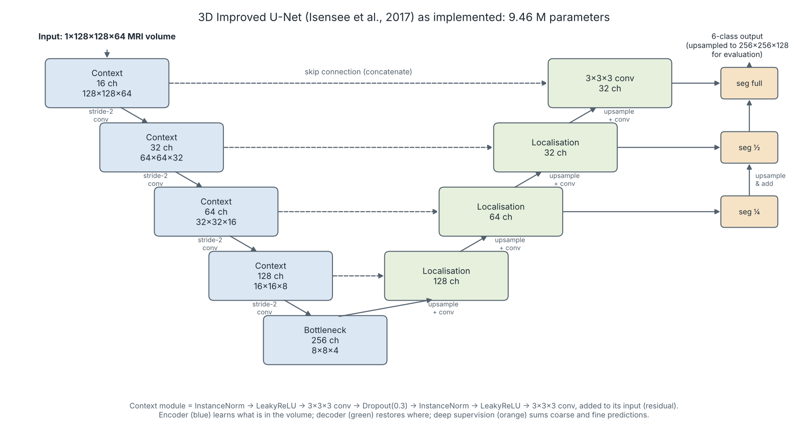
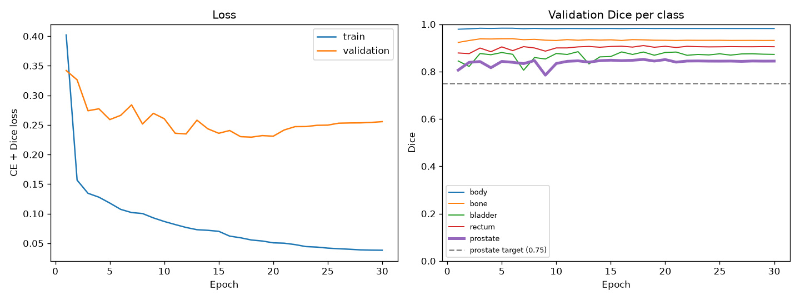
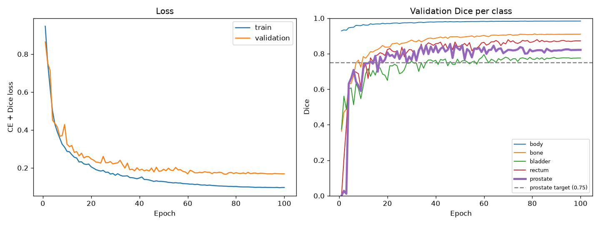
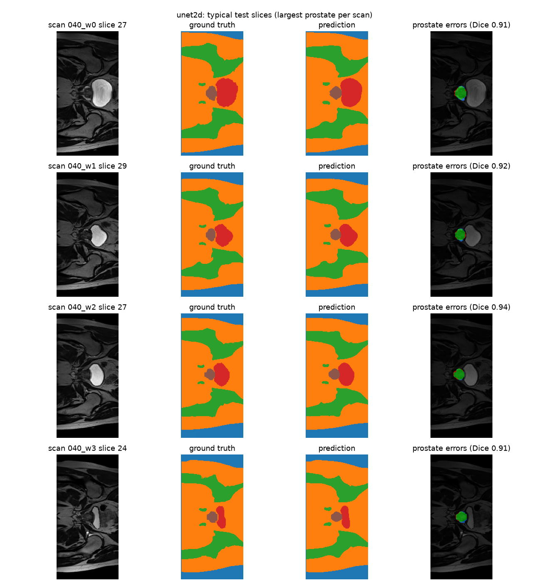
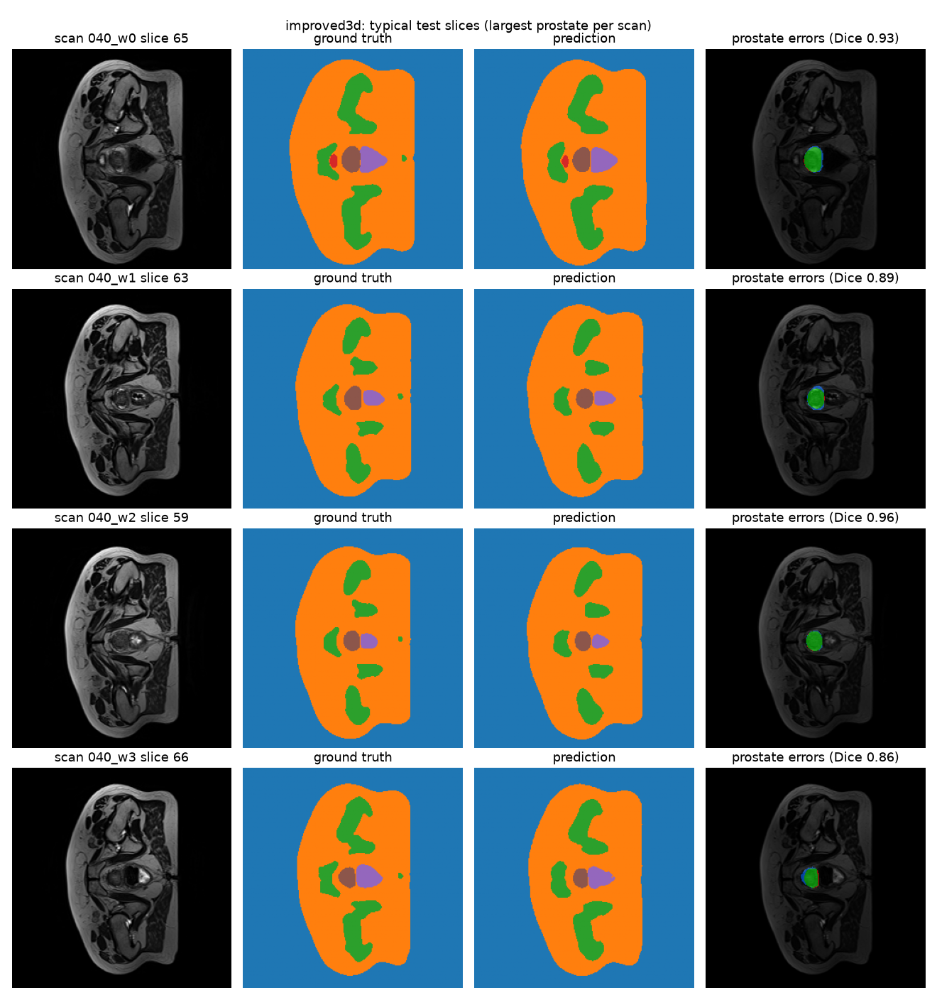
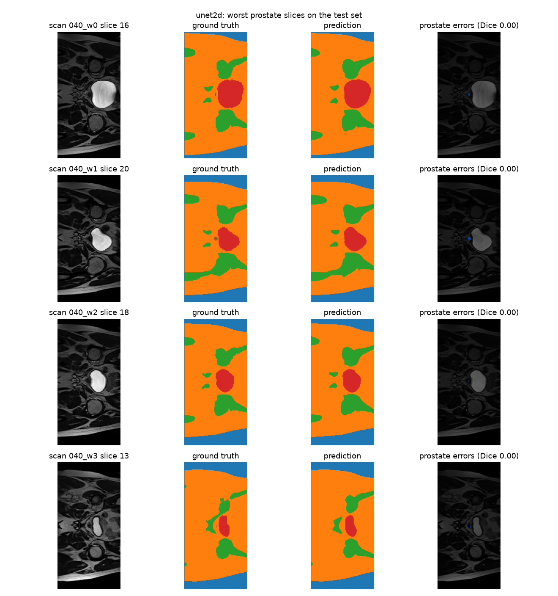
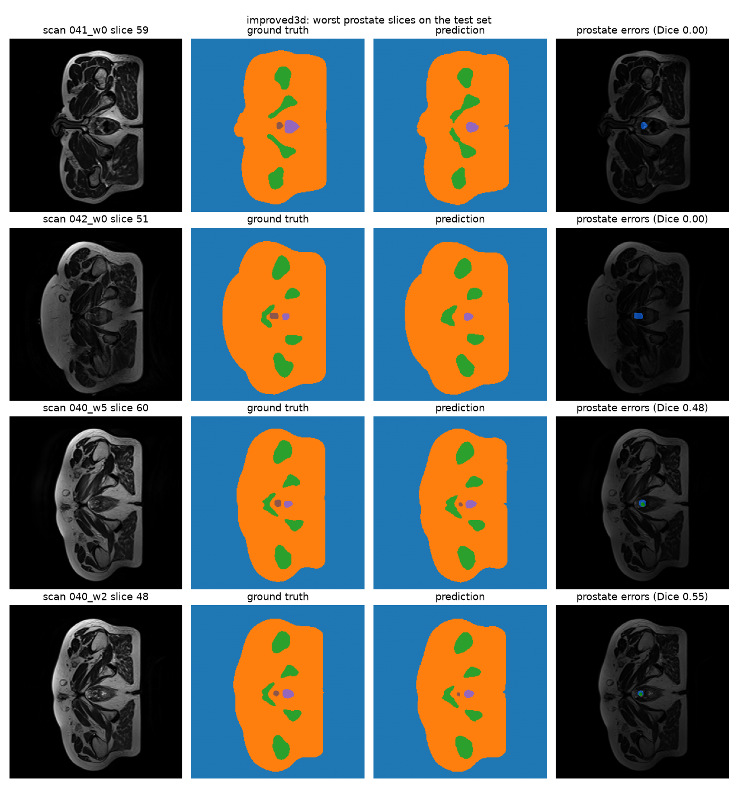

# Does 3D Context Help? Prostate Segmentation on HipMRI with a 2D U-Net and a 3D Improved U-Net

**Author:** Hafizh Surya Mustafa Zen (49800405)
**Course:** COMP3710 Pattern Recognition, The University of Queensland, 2026
**Problem:** Segmentation, HipMRI prostate (Section 2.2)
**Main model:** 3D Improved U-Net [Hard difficulty] · **Baseline:** 2D U-Net [Easy difficulty]

---

## Contents

1. [Overview](#1-overview)
2. [How the Algorithm Works](#2-how-the-algorithm-works)
3. [Feasibility Review](#3-feasibility-review)
4. [Dataset, Pre-processing and Data Splits](#4-dataset-pre-processing-and-data-splits)
5. [Training Setup](#5-training-setup)
6. [Results](#6-results)
7. [Investigation of the Open Research Dilemma](#7-investigation-of-the-open-research-dilemma)
8. [Usage](#8-usage)
9. [Dependencies and Reproducibility](#9-dependencies-and-reproducibility)
10. [Repository Structure](#10-repository-structure)
11. [Limitations and Future Work](#11-limitations-and-future-work)
12. [Artificial Intelligence Usage Disclosure](#12-artificial-intelligence-usage-disclosure)
13. [References](#13-references)

---

## 1. Overview

In prostate cancer radiotherapy, clinicians must outline (or *contour*) the prostate and the organs around it on every planning scan. The aim is to deliver a high radiation dose to the prostate while protecting the bladder and rectum, which sit only a few millimetres away. Manual contouring is slow, and different clinicians often draw slightly different boundaries. Automatic segmentation can produce a first draft that a clinician then checks and corrects.

This project builds and compares two deep learning models that segment pelvic MRI scans from the HipMRI study into six classes: background, body, bone, bladder, rectum and prostate. The first is a **2D U-Net** [1], which labels each MRI slice on its own. The second is a **3D Improved U-Net** [2], which processes the whole volume at once and can therefore use information from the slices above and below. The project is built around the open question set for this domain: *does 3D volumetric context genuinely reduce errors at the difficult top (base) and bottom (apex) of the prostate, or does it simply cost more computation while only improving the easy central slices?*

**Headline result.** On the same nine held-out test scans, scored at full native resolution, the two models reach almost identical overall prostate Dice (0.863 for 2D and 0.859 for 3D). However, the 3D model is clearly better on the boundary slices of the prostate (Dice 0.778 compared with 0.707), which is exactly where the dilemma predicts 2D models fail. This advantage comes at a cost: the downsampling needed to fit the 3D volumes into memory blurs thin structures, so the 3D model is weaker on the rectum (0.818 compared with 0.851). Both models comfortably exceed their targets (Dice ≥ 0.75 for the 2D model and ≥ 0.70 for the 3D model).

---

## 2. How the Algorithm Works

Both models follow the U-Net design. An **encoder** repeatedly shrinks the input while increasing the number of feature channels, so that deeper layers capture *what* is in the image (for example, "this region is bladder"). A **decoder** then enlarges the features back to the original size so that every pixel or voxel receives a label. **Skip connections** pass detailed feature maps directly from each encoder level to the matching decoder level; this restores the fine spatial detail that is lost while shrinking, which is essential for sharp organ boundaries. The final layer outputs six scores per voxel, one for each class, and the class with the highest score becomes the prediction.

The **3D Improved U-Net** (Figure 1) extends this design in several ways, following Isensee et al. [2]:

- **3D convolutions** (3×3×3 filters) let every filter see neighbouring slices, which is the "volumetric context" the dilemma is about.
- **Residual context modules.** Each encoder block learns a correction that is *added* to its input instead of replacing it. This makes deep networks easier to train.
- **Strided convolutions** perform the downsampling instead of max-pooling, so the network learns how to downsample.
- **Deep supervision.** Segmentation maps are produced at three decoder levels (¼, ½ and full resolution), upsampled and summed. This gives the deeper layers a direct training signal and tends to help with small structures.
- **Instance normalisation, Leaky ReLU and dropout (0.3).** Instance normalisation works better than batch normalisation when the batch is very small (two volumes here), and dropout reduces overfitting.

The implemented network has 9.46 million parameters. Two switches (`residual` and `deep_supervision`) can turn the extra features off, which turns the model into a plainer 3D U-Net. This version is available as a fallback and for ablation studies (`--model plain3d`).



*Figure 1. The 3D Improved U-Net as implemented. Blue: encoder context modules; green: decoder localisation modules; orange: deep supervision outputs. The channel counts and sizes are for a 128×128×64 input.*

The **2D U-Net baseline** follows the original design [1]: four downsampling steps (max-pooling) and four upsampling steps (transposed convolutions), with two 3×3 convolutions at each level, giving 64 to 1024 channels and 31.0 million parameters. Two small changes from the original paper were made. Padded convolutions keep the output the same size as the input, and batch normalisation follows every convolution to make training more stable.

---

## 3. Feasibility Review

*This is the one-page review presented at the compulsory midpoint check-off.*

### 3.1 User Need, Scope and Acceptance Criteria

**User:** a radiotherapy planning team that needs first-draft contours of the prostate and nearby organs (bladder, rectum, bone) on pelvic MRI, to shorten manual contouring.

**Scope:** a research prototype that produces draft contours for clinician review only. It makes no treatment decisions and uses HipMRI data alone. It asks whether 3D volumetric context reduces errors at the prostate base and apex, or simply costs more compute. All criteria are tested on the held-out test patients (cases 040–042, 9 scans):

| ID | Criterion and test | Pass threshold |
|---|---|---|
| AC1 | Test prostate Dice at full native resolution | 3D ≥ 0.70; 2D baseline ≥ 0.75 |
| AC2 | Prostate Dice on boundary slices (first and last 20% of prostate-containing slices per scan) | 3D > 2D baseline |
| AC3 | Change in rectum and bladder Dice, 3D vs 2D (leakage at organ interfaces) | Drop ≤ 0.02 each |
| AC4 | Training time; peak GPU memory; inference per scan | ≤ 5× baseline; ≤ 16 GB; ≤ 2 s |

### 3.2 Model Choice and Course Concepts

**Data:** the HipMRI 2D slices for the baseline and the 3D volumes for the main model, using the course's patient-level split (31 / 4 / 3 patients). The 3D volumes are z-score normalised, downsampled ×2 from 256×256×128 to 128×128×64 (trilinear for images, nearest-neighbour for masks) and randomly flipped along each axis during training.

**Models:** a 2D U-Net baseline [1] (Easy, 31.0 M parameters) and the main model, a 3D Improved U-Net [2] (Hard, 9.5 M), with residual context modules, deep supervision and instance normalisation. Both are trained with the same combined cross-entropy and Dice loss and the Adam optimiser with cosine learning-rate decay, so the main difference between them is the spatial context.

**Course concepts:** encoder–decoder CNNs with skip connections to preserve boundary detail; residual learning for stable deep training; normalisation; augmentation; and a Dice-based loss to counter class imbalance, since the prostate occupies a very small fraction of each image. 3D convolutions [3] extend each filter to neighbouring slices, which is exactly the context the dilemma asks about.

### 3.3 Preliminary Feasibility Evidence

- **Data audit:** the official split has no patient overlap; images and masks pair one-to-one (11,460 / 660 / 540 slices); six labels (0–5); the 2D and 3D sets cover the same nine test scans.
- **Pipeline:** both models train and evaluate end to end. The 3D model is scored by upsampling its predictions to the original 256×256×128 and comparing them with the original masks.

| Model | Prostate Dice | Boundary | Middle | Rectum | Train time | Inference / scan |
|---|---|---|---|---|---|---|
| 2D U-Net (baseline) | 0.863 | 0.707 | 0.898 | 0.851 | 4.1 h | 0.74 s |
| 3D Improved U-Net | 0.859 | 0.778 | 0.903 | 0.818 | 12.1 h | 0.84 s |

*Measured on an Apple M2 Pro (MPS), which cannot report peak GPU memory.*

AC1 and AC2 are met. AC3 narrowly fails (rectum −0.033), most likely because downsampling blurs thin structures. AC4 is met for time (about 3×), but peak memory has not yet been measured.

### 3.4 Risks, Budget and Fallback

- **Small test set** (3 patients, 7 of the 9 scans from one patient): report per-scan results and avoid claiming small differences.
- **Detail lost by downsampling** at the apex and the rectal wall: score at full resolution; try full-resolution patch training.
- **Compute access:** the Rangpur queue has been unavailable, and the Mac cannot measure VRAM. Use an RTX 5060 laptop or Rangpur when free.

**Budget:** about 24 GPU-hours for the remaining experiments.

**Next experiment:** measure peak VRAM on a CUDA GPU to complete AC4, then train the 3D model on 128-voxel patches at full resolution to target AC3.

**Fallback:** if patch training exceeds the budget, keep the current downsampled 3D model, which already meets AC1 and AC2. A plain 3D U-Net (the same network with residuals and deep supervision switched off) is already implemented as a Normal-difficulty alternative.

---

## 4. Dataset, Pre-processing and Data Splits

### 4.1 Dataset

The HipMRI study for prostate cancer radiotherapy contains pelvic MRI scans of 38 patients. Most patients were scanned weekly during treatment, which gives 211 3D volumes in total. The body outline, bone, bladder, rectum and prostate were segmented in 3D by an MR physicist with more than ten years of experience. The course provides two versions of the data on Rangpur (`/home/groups/comp3710/HipMRI_Study_open`):

| Version | Folder | Content | Size |
|---|---|---|---|
| 2D slices | `keras_slices_data/` | 2D slices, mostly 256×128 pixels, with matching masks | 12,660 slices |
| 3D volumes | `semantic_MRs/`, `semantic_labels_only/` | full 3D volumes (256×256×128, voxel size ≈1.56 mm) with matching masks | 211 volumes |

Each mask voxel holds one of six labels: **0** background, **1** body, **2** bone, **3** bladder, **4** rectum, **5** prostate. The prostate is the hardest class because it is small (only a few percent of the voxels) and its boundaries with the bladder and rectum have low contrast.

**Note on the two versions.** I checked whether the 2D slices are direct cuts of the 3D volumes, testing cuts along all three axes, cropped axial slices and resampled axial slices in all orientations (`audit_2d_vs_3d.py`, `audit_axial.py`, `audit_resampled.py`). None of them matched (the best correlation was about 0.68), so the 2D slices were evidently produced with separate pre-processing. For this reason, each model is scored at its own native resolution, but always on the **same nine test scans**.

### 4.2 Data Splits and Their Justification

I used the course's official split, which is defined by patient number. My code checks that it is leak-free: `check_no_patient_leakage()` raises an error if any patient appears in more than one split.

| Split | Patients (case IDs) | 2D slices | 3D volumes | Purpose |
|---|---|---|---|---|
| Train | 31 (004–035) | 11,460 | 191 | learning the weights |
| Validate | 4 (036–039) | 660 | 11 | choosing the best epoch |
| Test | 3 (040–042) | 540 | 9 | final, one-off evaluation |

**Why split by patient?** Slices from the same patient, and scans of the same patient from different weeks, look extremely similar. If one patient appeared in both the training and test sets, the model would essentially be tested on data it had already seen, and the scores would be misleadingly high. Splitting by patient ensures that the test score reflects performance on *new* patients, which is what matters clinically.

**Why the same split for both models?** It makes the comparison fair: both models are trained on the same patients and tested on exactly the same nine scans (seven from patient 040, one each from 041 and 042). This is also the main limitation: three test patients is a very small sample, so small differences between the models should not be over-interpreted (see Section 11).

The validation set is used only to pick the best checkpoint (the epoch with the highest validation prostate Dice). The test set is used once, at the very end.

### 4.3 Pre-processing

| Step | 2D U-Net | 3D Improved U-Net | Why |
|---|---|---|---|
| Loading | `nibabel`; drop the extra trailing dimension some files have | same | adapted from the course's Appendix B loader |
| Size | centre-crop the few 256×144 slices to 256×128 | downsample 256×256×128 → 128×128×64 | every sample in a batch must be the same size; full-size 3D volumes are too large for available memory |
| Resampling | — | images: trilinear; masks: nearest-neighbour | nearest-neighbour keeps labels as whole numbers (blending labels 3 and 5 into "4" would be meaningless) |
| Intensity | z-score per slice: (x − mean) / std | z-score per volume | MRI intensities vary a lot between scans; this puts every input on the same scale (as in Appendix B) |
| Augmentation | none | random flip along each axis (50% each) | the 3D model has only 191 training volumes, so flipping adds useful variety [4] |
| Mask format | integer labels 0–5 | same | `CrossEntropyLoss` uses integer labels directly; the Dice loss one-hot encodes them internally |

The masks are flipped and cropped in exactly the same way as their images, so the two always stay aligned voxel-for-voxel.

---

## 5. Training Setup

Both models use the same loss, optimiser and learning-rate schedule, so the main experimental difference is the spatial context (2D slices vs 3D volumes).

**Loss: cross-entropy + Dice.** Cross-entropy scores each voxel independently. On its own, it would largely ignore the prostate, because a model that never predicts prostate is still correct on about 98% of voxels. The soft Dice loss [5] measures the overlap for each foreground class and weights all classes equally, regardless of their size, which forces the model to take the small prostate seriously. Combining the two is a common and robust choice in medical segmentation.

| Setting | 2D U-Net | 3D Improved U-Net |
|---|---|---|
| Input | 1×256×128 slice | 1×128×128×64 volume |
| Parameters | 31,036,806 | 9,464,674 |
| Batch size | 16 | 2 |
| Epochs | 30 | 100 |
| Optimiser | Adam, learning rate 1e-3 | Adam, learning rate 1e-3 |
| Schedule | cosine decay to ~0 | cosine decay to ~0 |
| Loss | cross-entropy + Dice | cross-entropy + Dice |
| Checkpoint | best validation prostate Dice (epoch 18) | best validation prostate Dice (epoch 46) |
| Hardware | Apple M2 Pro (MPS), float32 | Apple M2 Pro (MPS), float32 |
| Training time | 4.1 h (~8.2 min/epoch) | 12.1 h (~7.2 min/epoch) |
| Random seed | 42 | 42 |

The 3D model was trained for more epochs because each epoch contains far fewer samples (191 volumes compared with 11,460 slices), so it receives far fewer weight updates per epoch. Its best validation Dice was reached at epoch 46, and later epochs gave no further improvement.

**Training curves.** The 2D model learned quickly: its validation prostate Dice reached 0.84 by epoch 3, and later epochs added only about 0.01. After roughly epoch 18 the validation loss began to rise slightly while the training loss kept falling, a sign of mild overfitting; saving the best checkpoint guarded against this. The 3D model learned more slowly and its validation Dice was noisy (between about 0.77 and 0.85 from epoch 20 onward), because the validation set contains only 11 volumes.



*Figure 2. 2D U-Net: training and validation loss (left) and validation Dice per class (right).*



*Figure 3. 3D Improved U-Net: training and validation loss (left) and validation Dice per class (right).*

---

## 6. Results

All results below are on the held-out test set (9 scans, 3 patients). The 3D predictions were upsampled back to the original 256×256×128 resolution and compared with the **original** masks. Scoring the 3D model against its own downsampled masks would make it look better than it really is: at 128×128×64, its prostate Dice is 0.874, but at full resolution it drops to 0.859.

### 6.1 Per-class Dice and IoU

Dice = 2|P ∩ T| / (|P| + |T|) and IoU = |P ∩ T| / |P ∪ T|, where P is the prediction and T is the ground truth. Both are pooled over all test voxels.

| Class | 2D U-Net Dice | 2D U-Net IoU | 3D Improved U-Net Dice | 3D Improved U-Net IoU |
|---|---|---|---|---|
| Background | 0.997 | 0.994 | 0.994 | 0.988 |
| Body | 0.984 | 0.969 | 0.977 | 0.956 |
| Bone | 0.933 | 0.874 | 0.896 | 0.812 |
| Bladder | 0.966 | 0.935 | 0.945 | 0.896 |
| Rectum | 0.851 | 0.740 | 0.818 | 0.691 |
| **Prostate** | **0.863** | **0.759** | **0.859** | **0.753** |

Both models pass their targets: 0.863 ≥ 0.75 (2D) and 0.859 ≥ 0.70 (3D).

### 6.2 Prostate Dice per Scan (Paired Comparison)

Because both models are evaluated on the same nine scans, they can be compared scan by scan.

| Scan | 2D U-Net | 3D Improved U-Net | Better |
|---|---|---|---|
| 040 week 0 | 0.875 | 0.877 | 3D |
| 040 week 1 | 0.879 | 0.854 | 2D |
| 040 week 2 | 0.892 | 0.888 | 2D |
| 040 week 3 | 0.866 | 0.838 | 2D |
| 040 week 4 | 0.840 | 0.804 | 2D |
| 040 week 5 | 0.884 | 0.883 | ≈ tie |
| 040 week 7 | 0.864 | 0.881 | 3D |
| 041 week 0 | 0.858 | 0.905 | 3D |
| 042 week 0 | 0.840 | 0.833 | 2D |
| **Mean ± std** | **0.866 ± 0.017** | **0.863 ± 0.030** | |

The average difference is only about 0.004, and each model wins on some scans. **Overall, the two models perform equally well.**

### 6.3 Example Inputs and Outputs



*Figure 4. 2D U-Net on typical test slices (the slice with the most prostate in each scan). Columns: input MRI, ground truth, prediction and prostate error map (green = correct, red = false positive, blue = missed).*



*Figure 5. 3D Improved U-Net on typical test slices, shown at full resolution after upsampling. Same layout as Figure 4.*

In the label maps, the colours are: blue = background, orange = body, green = bone, red = bladder, purple = rectum, brown = prostate.

---

## 7. Investigation of the Open Research Dilemma

> *Does incorporating true 3D volumetric continuity genuinely eliminate hazardous boundary and slice-transition errors compared with a standard 2D baseline, or does it merely smooth easy central slices while demanding far more GPU memory and training time?*

### 7.1 Quantitative Benchmark: Boundary vs Middle Slices

To test the dilemma directly, the prostate-containing slices of each scan were divided into **boundary slices** (the first and last 20%, which lie at the base and apex of the gland) and **middle slices** (the remaining 60%). Dice was pooled over each group.

| Region | 2D U-Net | 3D Improved U-Net | Difference |
|---|---|---|---|
| Boundary slices (base and apex) | 0.707 | **0.778** | **+0.071** |
| Middle slices | 0.898 | 0.903 | +0.005 |
| Whole prostate | 0.863 | 0.859 | −0.004 |

This is the central finding. In the middle of the gland the two models are effectively identical, because the prostate is large and clearly visible there and one slice is enough to segment it. At the boundaries, however, the 3D model is substantially better. **3D context does not merely smooth the easy central slices; its gain is concentrated precisely at the boundaries, where the dilemma predicts 2D models fail.** Its overall Dice is not higher only because it loses accuracy elsewhere, as Section 7.3 explains.

*Note:* for the 2D model, "slice order" follows the 2D dataset's slice numbering; for the 3D model, it follows the last axis of the volume. As explained in Section 4.1, the two datasets cannot be aligned voxel-for-voxel, so these two orderings may not correspond to exactly the same anatomical direction.

### 7.2 Resource Profiling

| Metric | 2D U-Net | 3D Improved U-Net |
|---|---|---|
| Parameters | 31.0 M | 9.5 M |
| Training time (M2 Pro, MPS) | 4.1 h | 12.1 h (≈3×) |
| Inference per scan, model only (M2 Pro, MPS) | 0.74 s (60 slices) | 0.84 s |
| Peak GPU memory, training | *TODO: measure on CUDA* | *TODO: measure on CUDA* |
| Peak GPU memory, inference | *TODO: measure on CUDA* | *TODO: measure on CUDA* |

Inference time was measured after a warm-up pass, with GPU synchronisation, and covers only the model's forward pass (no file loading). Timings on MPS vary by about ±10% between runs (a repeat run gave 0.82 s for 2D and 0.83 s for 3D), so the two models should be regarded as equally fast at inference. All Dice values were identical across the two runs. Apple's MPS backend cannot report peak memory, so the VRAM figures must be measured on an NVIDIA GPU (`predict.py` and `train.py` report them automatically on CUDA).

Two observations stand out. First, the 3D model has **about a third of the parameters** of the 2D baseline, so "3D" does not automatically mean "bigger"; the extra cost comes from the size of the 3D activations, not from the weights. Second, the 3D model needed about **3× the training time**, which is at the lower end of the 5–10× range anticipated in the dilemma. This was only possible because of the ×2 downsampling, which reduces the number of voxels by a factor of eight.

### 7.3 Failure Case Autopsy

The figures below show the four worst test slices for each model (at most one per scan).



*Figure 6. The worst prostate slices for the 2D U-Net.*



*Figure 7. The worst prostate slices for the 3D Improved U-Net.*

**Overall pattern.** Across both models, the worst-performing slices share one characteristic: they are all cases of under-segmentation, where prostate tissue is missed rather than wrongly added. Neither model labelled any part of the bladder or rectum as prostate. What differs between the two models is *where* the failures occur. The 2D U-Net struggles at the base of the prostate, next to the bladder, whereas the 3D Improved U-Net struggles at the apex, near the rectum. In both regions the prostate is at its smallest, which makes it hardest to detect.

**Case 1: 2D U-Net, scan 040_w0, slice 16 (Dice 0.00).** This slice passes through the bladder, and the ground truth contains only a small cluster of prostate pixels along the bladder's edge, which corresponds to the very top of the gland. The 2D model classified these pixels as bladder or surrounding tissue. This is understandable given how the model works: within a single slice, a handful of prostate pixels touching the bladder is visually very similar to the bladder wall. Because the model processes each slice independently, it cannot use the slices below, where the prostate is much more clearly defined.

**Case 2: 2D U-Net, scans 040_w1, w2 and w3, slices 13–20 (Dice 0.00).** The same error appears in all four of the worst 2D slices. Each one is taken at the level of the bladder, contains only a small fragment of prostate, and is missed entirely. The consistency of this pattern suggests a systematic limitation of slice-wise segmentation rather than an isolated mistake. It is also precisely the type of error that additional 3D context is expected to resolve.

**Case 3: 3D Improved U-Net, scans 041_w0 (slice 59) and 042_w0 (slice 51) (Dice 0.00).** These slices lie below the bladder, close to the apex of the prostate. In the ground truth, the prostate appears as a small region directly in front of the rectum. The 3D model segmented the rectum correctly but failed to detect the prostate at all. The most likely explanation is the downsampling required to fit the volumes into memory. At a resolution of 128×128×64, the apex is only a few voxels wide, so very little information about it survives. Once this detail is lost, upsampling the prediction back to full resolution cannot recover it.

**Case 4: 3D Improved U-Net, scans 040_w5 (slice 60) and 040_w2 (slice 48) (Dice 0.48 and 0.55).** In these cases the model located the prostate correctly but predicted a region noticeably smaller than the ground truth. This appears to have the same underlying cause as Case 3: halving the resolution in each dimension tends to smooth out the boundaries of small structures, which leads to systematic under-estimation of their size.

**Clinical relevance.** Under-segmentation at the base or apex is not a minor technical issue. In radiotherapy planning, it could result in part of the prostate edge receiving insufficient radiation dose. The results show that the 3D model's improvement on boundary slices (Dice rising from 0.71 to 0.78) comes largely from correcting the 2D model's failures at the base. However, the downsampling it depends on introduces a new weakness at the apex. In other words, 3D context helps, but only if enough spatial resolution is preserved.

**A note on interpretation.** Slice-level Dice is highly sensitive when the ground truth contains only a few pixels, since a difference of just a handful of pixels can move the score from 0 to 1. It is also possible that some of these small fragments reflect partial-volume effects in the manual annotations rather than genuine prostate tissue.

### 7.4 Engineering Recommendation for the Project Manager

**Recommendation:** adopt the **3D Improved U-Net** as the basis of the contouring pipeline, but with three conditions.

1. **Use 3D where boundary accuracy matters.** The 3D model improves boundary-slice Dice by about 0.07 while matching the 2D model elsewhere. In radiotherapy, the edges of the prostate are exactly where contouring errors cause harm (under-dosing the tumour or over-dosing the bladder and rectum), so this is the gain that matters most.
2. **Do not accept the downsampling penalty in production.** At half resolution, the 3D model loses accuracy on thin structures (rectum Dice −0.033, bone −0.037) and misses the prostate apex in some scans. Before deployment, it should be trained at full resolution using patch-based sampling, which keeps the benefit of 3D context without discarding fine detail.
3. **Keep a clinician in the loop for apex and base slices.** Both models fail by *missing* small prostate fragments at the ends of the gland, never by leaking into other organs. Automatic drafts are therefore reliable for the central gland, bladder and body outline, but the first and last few prostate slices should always be reviewed manually.

**Trade-off summary.**

| Factor | 2D U-Net | 3D Improved U-Net |
|---|---|---|
| Overall prostate accuracy | equal | equal |
| Base and apex (boundary) accuracy | weaker | **stronger (+0.07)** |
| Thin structures (rectum, bone) | **stronger** | weaker (due to downsampling) |
| Model size | 31.0 M parameters | **9.5 M parameters** |
| Training cost | **4.1 h** | 12.1 h (≈3×) |
| Inference cost | similar (0.74 s) | similar (0.84 s) |
| Failure mode | misses base fragments next to the bladder | misses or shrinks the apex |

In short, the additional training cost of 3D context (about 3×) is justified, because the improvement is concentrated in the clinically critical boundary region. However, the full benefit can only be realised if enough resolution is preserved.

---

## 8. Usage

### 8.1 Data

The data is not included in this repository. On Rangpur it is available at `/home/groups/comp3710/HipMRI_Study_open`. To work locally, copy it to your own machine (the default paths in the code point to Rangpur, so pass `--data-root` when running locally):

```bash
# On Rangpur: pack the data
tar -czf ~/hipmri_2d.tar.gz -C /home/groups/comp3710/HipMRI_Study_open keras_slices_data
cd /home/groups/comp3710/HipMRI_Study_open && tar -czf ~/hipmri_3d.tar.gz semantic_MRs semantic_labels_only

# On your machine: download and unpack
mkdir -p ~/Datasets/HipMRI && cd ~/Datasets/HipMRI
scp <user>@rangpur.compute.eait.uq.edu.au:~/hipmri_2d.tar.gz .
scp <user>@rangpur.compute.eait.uq.edu.au:~/hipmri_3d.tar.gz .
tar -xzf hipmri_2d.tar.gz && tar -xzf hipmri_3d.tar.gz
```

### 8.2 Quick Checks

```bash
python dataset.py   # checks the 2D split for patient leakage and saves a preview image (Rangpur paths)
python modules.py   # pushes a random batch through the 2D U-Net and prints the output shape and parameters
python train.py --smoke --data-root ~/Datasets/HipMRI/keras_slices_data             # 2D end-to-end test
python train.py --smoke --model improved3d --data-root ~/Datasets/HipMRI            # 3D end-to-end test
```

### 8.3 Training

```bash
# 2D U-Net baseline (about 4 h on an M2 Pro)
python train.py --model unet2d --epochs 30 --preload --num-workers 0 \
    --data-root ~/Datasets/HipMRI/keras_slices_data

# 3D Improved U-Net (about 12 h on an M2 Pro)
PYTORCH_ENABLE_MPS_FALLBACK=1 python train.py --model improved3d --epochs 100 \
    --data-root ~/Datasets/HipMRI

# Optional: plain 3D U-Net (residuals and deep supervision switched off)
python train.py --model plain3d --epochs 100 --data-root ~/Datasets/HipMRI
```

On Rangpur, the Slurm script `train_unet2d.slurm` can be submitted with `sbatch`. `--data-root` can then be omitted, because the default paths point to the Rangpur data. On Apple Silicon, `PYTORCH_ENABLE_MPS_FALLBACK=1` lets any 3D operation that MPS does not support fall back to the CPU.

Training saves the following files to `outputs/`:

| File | Content |
|---|---|
| `best_<model>.pt` | the best checkpoint (by validation prostate Dice) |
| `<model>_training_curves.png` | loss and per-class validation Dice curves |
| `<model>_history.json` | per-epoch loss and Dice values |
| `<model>_results.json` | test Dice/IoU, training time, parameters and peak VRAM (on CUDA) |

### 8.4 Evaluation and Figures

```bash
python predict.py --model unet2d --data-root ~/Datasets/HipMRI/keras_slices_data
PYTORCH_ENABLE_MPS_FALLBACK=1 python predict.py --model improved3d --data-root ~/Datasets/HipMRI
```

`predict.py` loads the best checkpoint and evaluates it on the test scans at full native resolution. It prints per-class Dice and IoU, per-scan prostate Dice, boundary vs middle Dice, inference time and (on CUDA) peak VRAM. It also saves:

| File | Content |
|---|---|
| `<model>_eval.json` | all of the metrics above |
| `<model>_worst_cases.png` | the four worst prostate slices, for the failure autopsy |
| `<model>_example_cases.png` | typical slices, for showing example outputs |

Example output (2D U-Net):

```text
Test set, full native resolution (9 scans)
class           Dice     IoU
background    0.9970  0.9941
...
prostate      0.8627  0.7586

Prostate Dice on boundary slices: 0.7073 | middle slices: 0.8983
Inference time per scan (model only): 739.6 ms
```

---

## 9. Dependencies and Reproducibility

| Package | Version | Used for |
|---|---|---|
| Python | 3.11 | |
| PyTorch | 2.14.1 | models, training, evaluation |
| nibabel | 5.4.2 | reading Nifti (`.nii.gz`) files |
| NumPy | 2.4.6 | pre-processing and evaluation (not used in `modules.py`) |
| Matplotlib | 3.11.2 | training curves and figures |

Installation:

```bash
conda create -n comp3710 python=3.11 -y
conda activate comp3710
pip install torch nibabel numpy matplotlib
```

**Reproducibility.**

- A fixed random seed (`--seed 42`) controls weight initialisation and data shuffling.
- All hyperparameters are stored inside each checkpoint and results file (`args` in `<model>_results.json`), so every run can be repeated exactly.
- The data split is fixed (the official patient-level split) and checked in code.
- Results may still vary slightly between runs and machines, because some GPU operations (on both MPS and CUDA) are not fully deterministic. On CUDA, `train.py` also uses bfloat16 mixed precision for speed, whereas the reported runs used float32 on MPS.
- The logs of the reported runs are in `results/` (`train_logs.txt`, `eval_logs.txt`, and the JSON files).

---

## 10. Repository Structure

```text
HipMRI_Prostate_Segmentation_s4980040/
├── dataset.py             # 2D and 3D data loading, pre-processing, patient-level split and leakage check
├── modules.py             # UNet2D and ImprovedUNet3D (PyTorch only, no NumPy)
├── utils.py               # Dice loss, combined loss, Dice/IoU metrics
├── train.py               # training, validation, checkpointing, curves, test evaluation
├── predict.py             # full-resolution test evaluation, boundary analysis, figures
├── train_unet2d.slurm     # Slurm batch script for Rangpur
├── audit_2d_vs_3d.py      # checks whether 2D slices are direct cuts of the 3D volumes
├── audit_axial.py         # ... or cropped axial slices
├── audit_resampled.py     # ... or resampled axial slices
├── feasibility_review.md  # one-page feasibility review (also in Section 3)
├── images/                # figures used in this README
├── results/               # metrics (JSON), logs, results summary, failure autopsy notes
└── README.md
```

Datasets, checkpoints (`*.pt`) and the `outputs/` folder are excluded via `.gitignore`.

---

## 11. Limitations and Future Work

**Limitations.**

- **Small test set.** Only three patients are held out for testing, and seven of the nine test scans come from a single patient (040). The scans are therefore not independent samples, and small differences between the models (such as the 0.004 overall Dice gap) are within noise. The boundary-slice difference (0.07) is larger and consistent with the failure autopsy, but it would still benefit from confirmation on more patients.
- **Noisy validation.** With only 11 validation volumes, the validation Dice of the 3D model fluctuated considerably, so the choice of best epoch is partly a matter of chance.
- **No voxel-level 2D/3D alignment.** Because the 2D slices could not be matched to the 3D volumes, the two models are compared on the same scans but not on identical voxels.
- **The boundary definition is a choice.** "The first and last 20% of prostate-containing slices" is a reasonable but arbitrary definition; other cut-offs could change the exact numbers.
- **Single run per model.** Each model was trained once (seed 42). Repeating training with several seeds would show how much of the difference is due to random initialisation.
- **Peak VRAM not yet measured,** because training was done on Apple Silicon.

**Future work.**

1. Train the 3D model at **full resolution on patches** (for example, 128-voxel crops of the 256×256×128 volumes) to keep detail at the apex and in the rectal wall.
2. Use a **boundary-weighted loss** that penalises missed edge voxels more heavily.
3. Run an **ablation study** with `--model plain3d` to measure how much the residual connections and deep supervision contribute.
4. Train with **several random seeds** and, if possible, use cross-validation across patients for more reliable comparisons.
5. Add **post-processing** such as keeping only the largest connected prostate component.

---

## 12. Artificial Intelligence Usage Disclosure

**Tools used.** Claude (Anthropic), used through a chat interface throughout the project.

**What AI assisted with.**

- **Planning:** explaining the assignment specification, comparing the available projects and planning the progression from the 2D baseline to the 3D model.
- **Code scaffolding:** drafting the initial versions of `dataset.py`, `modules.py`, `utils.py`, `train.py`, `predict.py`, the audit scripts and the Slurm script, including explanatory comments.
- **Environment setup and debugging:** setting up conda on Rangpur, SSH and file transfer, VS Code, git workflow and Slurm queue issues.
- **Analysis and writing:** helping to interpret the results and failure cases, and drafting and editing the wording of the feasibility review, failure autopsy and this README.

**How I verified the AI-assisted work.**

- **Smoke tests:** every script was run end to end on a few batches (`--smoke`) before full training, and `modules.py` checks the output shape of the model.
- **Data checks:** the data loader was checked against the raw data (image/mask counts, shapes, label values 0–5), the patient split is verified in code by `check_no_patient_leakage()`, and I inspected the label maps visually to confirm that label 5 corresponds to the prostate.
- **Sanity checks on results:** I monitored the training curves for overfitting and compared the 3D model at downsampled vs full resolution. I questioned an assumption about how the 2D and 3D datasets relate and tested it with three audit scripts, which showed that the slices cannot be matched voxel-for-voxel.
- **Traceability:** every number in this README comes from my own training and evaluation runs, and the raw outputs are in `results/`.
- I read and ran all of the code, and I take full responsibility for every line, loss function and metric in this submission.

---

## 13. References

[1] O. Ronneberger, P. Fischer, and T. Brox, "U-Net: Convolutional networks for biomedical image segmentation," in *Proc. MICCAI*, 2015, pp. 234–241.

[2] F. Isensee, P. Kickingereder, W. Wick, M. Bendszus, and K. H. Maier-Hein, "Brain tumor segmentation and radiomics survival prediction: Contribution to the BRATS 2017 challenge," in *Brainlesion: Glioma, Multiple Sclerosis, Stroke and TBI Models*, 2018, pp. 287–297.

[3] Ö. Çiçek, A. Abdulkadir, S. S. Lienkamp, T. Brox, and O. Ronneberger, "3D U-Net: Learning dense volumetric segmentation from sparse annotation," in *Proc. MICCAI*, 2016, pp. 424–432.

[4] F. Isensee, P. F. Jaeger, S. A. A. Kohl, J. Petersen, and K. H. Maier-Hein, "nnU-Net: a self-configuring method for deep learning-based biomedical image segmentation," *Nature Methods*, vol. 18, pp. 203–211, 2021.

[5] F. Milletari, N. Navab, and S.-A. Ahmadi, "V-Net: Fully convolutional neural networks for volumetric medical image segmentation," in *Proc. 3DV*, 2016, pp. 565–571.

[6] COMP3710 Pattern Recognition, "Report 2026" assignment specification, Appendix B (Nifti loading code), The University of Queensland, 2026.
