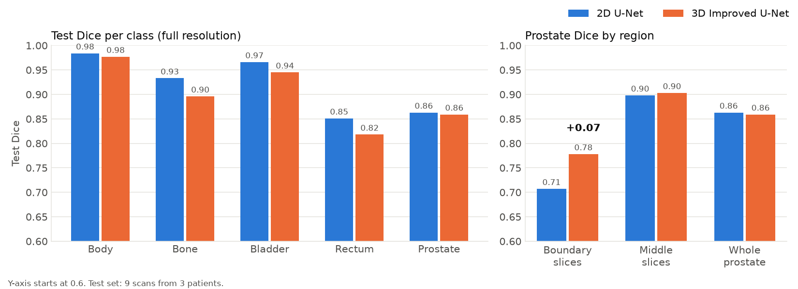
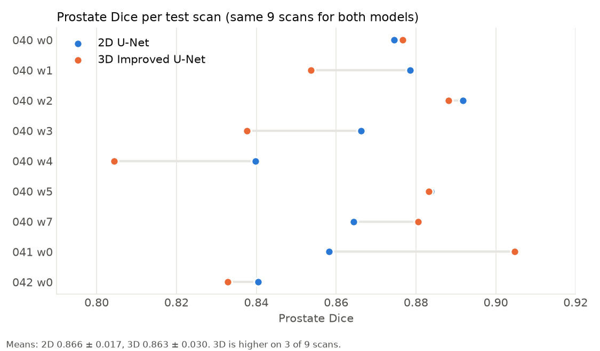
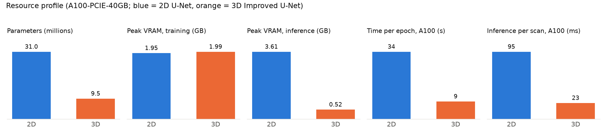

# Does 3D Context Help? Prostate Segmentation on HipMRI with a 2D U-Net and a 3D Improved U-Net

**Author:** Hafizh Surya Mustafa Zen (49800405)
**Course:** COMP3710 Pattern Recognition, The University of Queensland, 2026
**Problem:** Segmentation, HipMRI prostate (Section 2.2)
**Main model:** 3D Improved U-Net [Hard difficulty] · **Baseline:** 2D U-Net [Easy difficulty]

---

## Contents

1. [Overview](#1-overview)
2. [How the Algorithm Works](#2-how-the-algorithm-works)
3. [Feasibility Review](#3-feasibility-review)
4. [Dataset, Pre-processing and Data Splits](#4-dataset-pre-processing-and-data-splits)
5. [Training Setup](#5-training-setup)
6. [Results](#6-results)
7. [Investigation of the Open Research Dilemma](#7-investigation-of-the-open-research-dilemma)
8. [Usage](#8-usage)
9. [Dependencies and Reproducibility](#9-dependencies-and-reproducibility)
10. [Repository Structure](#10-repository-structure)
11. [Limitations and Future Work](#11-limitations-and-future-work)
12. [Artificial Intelligence Usage Disclosure](#12-artificial-intelligence-usage-disclosure)
13. [References](#13-references)

---

## 1. Overview

In prostate cancer radiotherapy, clinicians must outline (or *contour*) the prostate and its neighbouring organs on every planning scan, so that a high radiation dose can be delivered to the gland while the bladder and rectum, which lie only a few millimetres away, are spared. Manual contouring is time-consuming, and boundaries drawn by different clinicians frequently disagree. Automatic segmentation offers a way to produce a first draft that a clinician can then review and correct, provided it is reliable where it matters most.

This project develops and compares two deep learning models that segment pelvic MRI scans from the HipMRI study into six classes: background, body, bone, bladder, rectum and prostate. The first, a **2D U-Net** [1], labels each slice independently. The second, a **3D Improved U-Net** [2], processes an entire volume at once and can therefore draw on information from adjacent slices. The work is framed around the open question posed for this domain: *does 3D volumetric context genuinely reduce errors at the difficult superior (base) and inferior (apex) ends of the prostate, or does it merely add computational cost while improving only the easier central slices?*

**Headline result.** Evaluated on the same nine held-out test scans at full native resolution, the two models achieve almost identical overall prostate Dice (0.863 for 2D and 0.859 for 3D). The 3D model, however, is markedly more accurate on the boundary slices of the gland (Dice 0.778 against 0.707), which is precisely where the dilemma predicts slice-wise models to fail. This advantage is not free: the downsampling required to fit 3D volumes into memory blurs thin structures, leaving the 3D model weaker on the rectum (0.818 against 0.851). Profiling on an NVIDIA A100 showed that the 3D model needed no more GPU memory than the baseline (about 2 GB during training) and trained faster per epoch, so at this resolution the true price of 3D context is lost spatial detail rather than computation. Both models comfortably exceed their targets (Dice ≥ 0.75 for 2D and ≥ 0.70 for 3D).

---

## 2. How the Algorithm Works

Both models are built on the U-Net design. An **encoder** progressively reduces the spatial size of the input while increasing the number of feature channels, so that deeper layers capture *what* is present in the image (for instance, "this region is bladder"). A **decoder** then restores the features to the original resolution so that every pixel or voxel can be assigned a label. **Skip connections** pass detailed feature maps directly from each encoder level to the corresponding decoder level, recovering the fine spatial information lost during downsampling; this is essential for sharp organ boundaries. The final layer produces six scores per voxel, one per class, and the highest-scoring class becomes the prediction.

Following Isensee et al. [2], the **3D Improved U-Net** (Figure 1) extends this design in several respects:

- **3D convolutions** (3×3×3 filters) allow every filter to see neighbouring slices, which is exactly the "volumetric context" at the centre of the dilemma.
- **Residual context modules.** Each encoder block learns a correction that is *added* to its input rather than replacing it, which makes deep networks considerably easier to optimise.
- **Strided convolutions** replace max-pooling, so that the network learns how to downsample instead of applying a fixed rule.
- **Deep supervision.** Segmentation maps are generated at three decoder levels (¼, ½ and full resolution), upsampled and summed. This provides the deeper layers with a direct training signal and tends to benefit small structures.
- **Instance normalisation, Leaky ReLU and dropout (0.3).** Instance normalisation is better suited than batch normalisation to very small batches (two volumes here), while dropout limits overfitting.

The implemented network contains 9.46 million parameters. Two switches (`residual` and `deep_supervision`) can disable these additions, reducing the model to a plainer 3D U-Net that serves both as a fallback and as a basis for ablation studies (`--model plain3d`).


*Figure 1. The 3D Improved U-Net as implemented. Blue: encoder context modules; green: decoder localisation modules; orange: deep supervision outputs. The channel counts and sizes are for a 128×128×64 input.*

The **2D U-Net baseline** follows the original design [1], with four downsampling steps (max-pooling), four upsampling steps (transposed convolutions) and two 3×3 convolutions at each level, giving 64 to 1024 channels and 31.0 million parameters. Two minor departures from the original paper were made: padded convolutions keep the output the same size as the input, and batch normalisation follows every convolution to stabilise training.

---

## 3. Feasibility Review

*This is the one-page review presented at the compulsory midpoint check-off (23 October 2026). The tutor approved it without requesting changes. The results shown were those available at the time of the review.*

### 3.1 User Need, Scope and Acceptance Criteria

**User:** a radiotherapy planning team that redraws the prostate, bladder and rectum on each weekly planning MRI. Manual contouring is time-consuming, and the boundaries drawn by different clinicians often disagree.

**Scope:** a research prototype that produces draft contours for a clinician to check. It makes no dosing decisions and is limited to HipMRI data. The core question is whether 3D context reduces errors at the prostate base and apex, or simply costs more compute. All criteria are measured on the held-out test patients 040–042 (9 scans):

| ID | Criterion and test | Pass threshold | Status |
|---|---|---|---|
| AC1 | Pooled prostate Dice on the test set, at full native resolution | 3D ≥ 0.70; 2D baseline ≥ 0.75 | ✅ Met (0.859 / 0.863) |
| AC2 | Prostate Dice on boundary slices (first and last 20% of prostate-containing slices in each scan) | 3D higher than 2D baseline | ✅ Met (0.778 vs 0.707) |
| AC3 | Change in rectum and bladder Dice, 3D vs 2D (accuracy at organ interfaces) | Drop ≤ 0.02 for each organ | ❌ Not met (rectum −0.033) |
| AC4 | Training time; peak GPU memory; inference time per scan | ≤ 5× baseline; ≤ 16 GB; ≤ 2 s | ⚠️ Partly (3×; VRAM pending; 0.8 s) |

### 3.2 Model Choice and Course Concepts

**Data:** HipMRI, 38 patients. The 2D baseline uses the 256×128 slices (11,460 / 660 / 540); the main model uses the 3D volumes (256×256×128, voxels ≈1.56 mm; 191 / 11 / 9). Both use the course's patient-level split (31 / 4 / 3 patients), so the two models share the same nine test scans. Volumes are z-score normalised, downsampled ×2 to 128×128×64 (trilinear for images, nearest-neighbour for masks), and flipped at random along each axis during training.

**Models:** a 3D Improved U-Net [2] (9.46 M parameters) with residual context modules, strided-convolution downsampling, deep supervision at three decoder levels, instance normalisation and dropout 0.3, compared with a 2D U-Net baseline [1] (31.0 M). Both use the same cross-entropy + soft Dice loss, Adam (learning rate 1e-3) and cosine decay, so spatial context is the main difference. Two switches can disable the residuals and deep supervision, giving a plain 3D U-Net [3] without new code.

**Course concepts:** encoder–decoder CNNs with skip connections retain the fine detail needed at organ interfaces; 3D convolutions add the neighbouring slices that the dilemma is about; residual learning keeps deep training stable; instance normalisation suits the very small batch (2 volumes); a Dice-based loss counters severe class imbalance (the prostate is only 0.10% of 3D training voxels and 0.43% of 2D pixels, and appears in just 36% of 2D slices).

### 3.3 Preliminary Feasibility Evidence

- **Data audit:** no patient appears in two splits (checked in code); images and masks pair one-to-one; labels 0–5 throughout; the few 256×144 slices are centre-cropped. 190 of the 191 training volumes are 256×256×128 (one has 144 slices); in-plane voxel spacing varies from 1.56 to 1.88 mm (1.56 mm between slices) and is not resampled. Class shares (3D): bladder 0.57%, rectum 0.14%, prostate 0.10%. Three audit scripts tested whether the 2D slices are direct cuts, crops or resampled versions of the 3D volumes; none matched (best correlation ≈0.68). Each model is therefore scored at its own native resolution, on the same scans.
- **Fair 3D scoring:** 3D predictions are upsampled to 256×256×128 and compared with the original masks. Scored against the downsampled masks, prostate Dice would read 0.874; at full resolution it is 0.859.

**Results on the test set (Apple M2 Pro, MPS, float32):**

| Model | Prostate Dice | Per scan (mean ± sd) | Boundary | Middle | Rectum | Params | Training | Inference |
|---|---|---|---|---|---|---|---|---|
| 2D U-Net (baseline) | 0.863 | 0.866 ± 0.017 | 0.707 | 0.898 | 0.851 | 31.0 M | 4.1 h | ≈0.8 s |
| 3D Improved U-Net | 0.859 | 0.863 ± 0.030 | **0.778** | 0.903 | 0.818 | 9.5 M | 12.1 h | ≈0.8 s |

**Early reading:** overall accuracy is effectively tied, but the 3D gain is concentrated at the boundaries. The worst 2D slices miss small prostate fragments next to the bladder (base); the worst 3D slices miss or shrink the apex, which is only a few voxels wide after downsampling. Neither model leaks prostate into the bladder or rectum. Peak VRAM could not be measured, because MPS does not report it.

### 3.4 Risks, Budget and Fallback

- **Small test set** (3 patients, 7 of the 9 scans from patient 040): report per-scan results and only claim differences that are clearly larger than the scan-to-scan spread.
- **Resolution loss** at the apex and rectal wall caused by downsampling: always score at full resolution; test full-resolution patch training.
- **Noisy validation** (11 volumes) makes checkpoint selection partly chance: repeat with additional seeds if time allows.
- **Compute access:** the Rangpur queue has been unreliable and MPS cannot report VRAM: use an RTX 5060 laptop or Rangpur A100 when available.

**Budget:** ≈16 GPU-hours used so far (Mac); ≈24 GPU-hours planned for the remaining experiments.

**Next experiment:** measure peak training and inference VRAM for both models on a CUDA GPU (to complete AC4), then train the 3D model on 128-voxel patches at full resolution, aiming to pass AC3.

**Fallback:** if patch training does not fit the budget, keep the current downsampled model, which already meets AC1 and AC2 and answers the dilemma. If the 3D model had failed, the plain 3D U-Net (Normal difficulty) is already implemented.

---

## 4. Dataset, Pre-processing and Data Splits

### 4.1 Dataset

The HipMRI study for prostate cancer radiotherapy comprises pelvic MRI scans of 38 patients, most of whom were scanned weekly during treatment, giving 211 3D volumes in total. The body outline, bone, bladder, rectum and prostate were segmented in 3D by an MR physicist with more than ten years of experience. Two versions of the data are provided on Rangpur (`/home/groups/comp3710/HipMRI_Study_open`):

| Version | Folder | Content | Size |
|---|---|---|---|
| 2D slices | `keras_slices_data/` | 2D slices, mostly 256×128 pixels, with matching masks | 12,660 slices |
| 3D volumes | `semantic_MRs/`, `semantic_labels_only/` | full 3D volumes (256×256×128; voxel spacing 1.56–1.88 mm in-plane and 1.56 mm between slices) with matching masks | 211 volumes |

Each mask voxel carries one of six labels: **0** background, **1** body, **2** bone, **3** bladder, **4** rectum and **5** prostate. The prostate is the most challenging class, both because it is small and because its boundaries with the bladder and rectum are low in contrast. On the training split (`data_stats.py`), it occupies only **0.10% of 3D voxels** and **0.43% of 2D pixels**, and appears in just 36% of the 2D slices; the rectum (0.14% of voxels) and bladder (0.57%) are similarly scarce. This degree of class imbalance shaped the choice of loss function (Section 5).

**Note on the two versions.** Rather than assume that the 2D slices were simply cut from the 3D volumes, I tested this directly, comparing them against cuts along all three axes, cropped axial slices and resampled axial slices in every orientation (`audit_2d_vs_3d.py`, `audit_axial.py`, `audit_resampled.py`). None matched (the best correlation was about 0.68), which indicates that the 2D slices were produced through separate pre-processing. Each model is therefore evaluated at its own native resolution, but always on the **same nine test scans**.

### 4.2 Data Splits and Their Justification

I adopted the course's official split, which is defined by patient number, and verified in code that it is leak-free: `check_no_patient_leakage()` raises an error if any patient appears in more than one split.

| Split | Patients (case IDs) | 2D slices | 3D volumes | Purpose |
|---|---|---|---|---|
| Train | 31 (004–035) | 11,460 | 191 | learning the weights |
| Validate | 4 (036–039) | 660 | 11 | choosing the best epoch |
| Test | 3 (040–042) | 540 | 9 | final, one-off evaluation |

**Why split by patient?** Slices from the same patient, and scans of the same patient taken in different weeks, are extremely similar. If a patient appeared in both the training and test sets, the model would effectively be evaluated on data it had already seen, and its scores would be inflated. A patient-level split ensures that the test score reflects performance on *unseen* patients, which is what matters clinically.

**Why the same split for both models?** Using one split guarantees a fair comparison, since both models learn from the same patients and are tested on exactly the same nine scans (seven from patient 040 and one each from 041 and 042). It is also the study's principal limitation: three test patients constitute a very small sample, so minor differences between the models should not be over-interpreted (see Section 11).

The validation set serves only to select the best checkpoint (the epoch with the highest validation prostate Dice), and the test set is used once, at the very end.

### 4.3 Pre-processing

| Step | 2D U-Net | 3D Improved U-Net | Why |
|---|---|---|---|
| Loading | `nibabel`; drop the extra trailing dimension some files have | same | adapted from the course's Appendix B loader |
| Size | centre-crop the few 256×144 slices to 256×128 | downsample 256×256×128 → 128×128×64 | every sample in a batch must be the same size; full-size 3D volumes are too large for available memory |
| Resampling | — | images: trilinear; masks: nearest-neighbour | nearest-neighbour keeps labels as whole numbers (blending labels 3 and 5 into "4" would be meaningless) |
| Intensity | z-score per slice: (x − mean) / std | z-score per volume | MRI intensities vary a lot between scans; this puts every input on the same scale (as in Appendix B) |
| Augmentation | none | random flip along each axis (50% each) | the 3D model has only 191 training volumes, so flipping adds useful variety [4] |
| Mask format | integer labels 0–5 | same | `CrossEntropyLoss` uses integer labels directly; the Dice loss one-hot encodes them internally |

Every flip and crop is applied identically to an image and its mask, so the two remain aligned voxel-for-voxel throughout.

---

## 5. Training Setup

Both models share the same loss function, optimiser and learning-rate schedule, so that the principal experimental variable is the spatial context (2D slices against 3D volumes).

**Loss: cross-entropy + Dice.** Cross-entropy evaluates each voxel independently and, used alone, would largely neglect the prostate, since a model that never predicted it would still be correct on more than 99.5% of voxels. The soft Dice loss [5] instead measures overlap for each foreground class and weights all classes equally, regardless of size, which compels the model to attend to the small prostate. Combining the two is a well-established and robust choice in medical image segmentation.

| Setting | 2D U-Net | 3D Improved U-Net |
|---|---|---|
| Input | 1×256×128 slice | 1×128×128×64 volume |
| Parameters | 31,036,806 | 9,464,674 |
| Batch size | 16 | 2 |
| Epochs | 30 | 100 |
| Optimiser | Adam, learning rate 1e-3 | Adam, learning rate 1e-3 |
| Schedule | cosine decay to ~0 | cosine decay to ~0 |
| Loss | cross-entropy + Dice | cross-entropy + Dice |
| Checkpoint | best validation prostate Dice (epoch 18) | best validation prostate Dice (epoch 46) |
| Hardware | Apple M2 Pro (MPS), float32 | Apple M2 Pro (MPS), float32 |
| Training time | 4.1 h (~8.2 min/epoch) | 12.1 h (~7.2 min/epoch) |
| Random seed | 42 | 42 |

The 3D model was trained for more epochs because each epoch contains far fewer samples (191 volumes against 11,460 slices) and therefore far fewer weight updates. Its best validation Dice was reached at epoch 46, after which further training brought no improvement.

**Training curves.** The 2D model converged rapidly: its validation prostate Dice reached 0.84 by epoch 3, and subsequent epochs added only about 0.01. From roughly epoch 18 the validation loss began to rise slightly while the training loss continued to fall, a sign of mild overfitting against which checkpoint selection provided a safeguard. The 3D model learned more gradually, and its validation Dice fluctuated (between about 0.77 and 0.85 from epoch 20 onward), largely because the validation set contains only 11 volumes.


*Figure 2. 2D U-Net: training and validation loss (left) and validation Dice per class (right).*


*Figure 3. 3D Improved U-Net: training and validation loss (left) and validation Dice per class (right).*

---

## 6. Results

All results below refer to the held-out test set (9 scans, 3 patients). The 3D predictions were upsampled to the original 256×256×128 resolution and compared with the **original** masks. Scoring the 3D model against its own downsampled masks would overstate its accuracy: at 128×128×64 its prostate Dice is 0.874, whereas at full resolution it falls to 0.859.

### 6.1 Per-class Dice and IoU

Dice = 2|P ∩ T| / (|P| + |T|) and IoU = |P ∩ T| / |P ∪ T|, where P is the prediction and T is the ground truth. Both are pooled over all test voxels.

| Class | 2D U-Net Dice | 2D U-Net IoU | 3D Improved U-Net Dice | 3D Improved U-Net IoU |
|---|---|---|---|---|
| Background | 0.997 | 0.994 | 0.994 | 0.988 |
| Body | 0.984 | 0.969 | 0.977 | 0.956 |
| Bone | 0.933 | 0.874 | 0.896 | 0.812 |
| Bladder | 0.966 | 0.935 | 0.945 | 0.896 |
| Rectum | 0.851 | 0.740 | 0.818 | 0.691 |
| **Prostate** | **0.863** | **0.759** | **0.859** | **0.753** |

Both models meet their targets: 0.863 ≥ 0.75 (2D) and 0.859 ≥ 0.70 (3D). The 2D model is marginally ahead on every class, with the widest gaps on the thin structures (bone and rectum), which are precisely those most affected by the 3D model's downsampling.



*Figure 4. Left: test Dice per class at full resolution. Right: prostate Dice on boundary slices, middle slices and the whole gland (Section 7.1). The y-axis starts at 0.6.*

### 6.2 Prostate Dice per Scan (Paired Comparison)

Since both models are evaluated on the same nine scans, they can be compared directly, scan by scan.

| Scan | 2D U-Net | 3D Improved U-Net | Better |
|---|---|---|---|
| 040 week 0 | 0.875 | 0.877 | 3D |
| 040 week 1 | 0.879 | 0.854 | 2D |
| 040 week 2 | 0.892 | 0.888 | 2D |
| 040 week 3 | 0.866 | 0.838 | 2D |
| 040 week 4 | 0.840 | 0.804 | 2D |
| 040 week 5 | 0.884 | 0.883 | ≈ tie |
| 040 week 7 | 0.864 | 0.881 | 3D |
| 041 week 0 | 0.858 | 0.905 | 3D |
| 042 week 0 | 0.840 | 0.833 | 2D |
| **Mean ± std** | **0.866 ± 0.017** | **0.863 ± 0.030** | |

The mean difference is only about 0.004, and each model outperforms the other on some scans. **Overall, the two models perform equally well.** The 3D model's results are, however, more variable (standard deviation 0.030 against 0.017), producing both the best single score (scan 041, 0.905) and the worst (040 week 4, 0.804).



*Figure 5. Prostate Dice for each of the nine test scans. Each line joins the two models' scores on the same scan.*

### 6.3 Example Inputs and Outputs


*Figure 6. 2D U-Net on typical test slices (the slice with the most prostate in each scan). Columns: input MRI, ground truth, prediction and prostate error map (green = correct, red = false positive, blue = missed).*


*Figure 7. 3D Improved U-Net on typical test slices, shown at full resolution after upsampling. Same layout as Figure 6.*

Label-map colours: blue = background, orange = body, green = bone, red = bladder, purple = rectum, brown = prostate.

---

## 7. Investigation of the Open Research Dilemma

> *Does incorporating true 3D volumetric continuity genuinely eliminate hazardous boundary and slice-transition errors compared with a standard 2D baseline, or does it merely smooth easy central slices while demanding far more GPU memory and training time?*

### 7.1 Quantitative Benchmark: Boundary vs Middle Slices

To address the dilemma directly, the prostate-containing slices of each scan were divided into **boundary slices** (the first and last 20%, lying at the base and apex of the gland) and **middle slices** (the remaining 60%), and Dice was pooled within each group.

| Region | 2D U-Net | 3D Improved U-Net | Difference |
|---|---|---|---|
| Boundary slices (base and apex) | 0.707 | **0.778** | **+0.071** |
| Middle slices | 0.898 | 0.903 | +0.005 |
| Whole prostate | 0.863 | 0.859 | −0.004 |

This is the central finding of the project (Figure 4, right). In the middle of the gland the two models are effectively indistinguishable, because the prostate is large and clearly visible there and a single slice provides enough information. At the boundaries, by contrast, the 3D model is substantially more accurate. **3D context does not merely smooth the easy central slices; its benefit is concentrated at the boundaries, exactly where the dilemma predicts slice-wise models to fail.** Its overall Dice is no higher only because it loses accuracy elsewhere, as Section 7.3 explains.

*Note:* for the 2D model, slice order follows the 2D dataset's slice numbering, whereas for the 3D model it follows the last axis of the volume. As Section 4.1 explains, the two datasets cannot be aligned voxel-for-voxel, so these orderings may not correspond to precisely the same anatomical direction.

### 7.2 Resource Profiling

Training and evaluation were carried out on an Apple M2 Pro laptop (MPS). Since MPS cannot report peak GPU memory, both models were additionally profiled on a Rangpur **NVIDIA A100-PCIE-40GB** using `measure_vram.slurm`. Inference was profiled with the final checkpoints on the full test set, and training memory was recorded in a separate one-epoch run of each model, using the same batch sizes as the real runs and bfloat16 mixed precision (the CUDA default in `train.py`).

| Metric | 2D U-Net | 3D Improved U-Net |
|---|---|---|
| Parameters | 31.0 M | 9.5 M |
| Peak GPU memory, training (A100; batch 16 / 2; bf16) | 1.95 GB | 1.99 GB |
| Peak GPU memory, inference (A100; float32) | 3.61 GB | 0.52 GB |
| Inference per scan, model only (A100) | 95 ms (60 slices) | 23 ms (one 128×128×64 volume) |
| Inference per scan, model only (M2 Pro) | ≈0.8 s | ≈0.8 s |
| Training time per epoch (A100) | 34 s | 9 s |
| Training time per epoch (M2 Pro) | 8.2 min | 7.2 min |
| Full training run (M2 Pro, measured) | 4.1 h (30 epochs) | 12.1 h (100 epochs) |
| Full training run (A100, estimated) | ≈17 min | ≈15 min |



*Figure 8. Resource profile on an NVIDIA A100-PCIE-40GB. Each panel uses its own scale.*

**Measurement details.** Inference time was recorded after a warm-up pass and with GPU synchronisation, and covers only the forward pass; it excludes file loading and, for the 3D model, the upsampling of predictions to full resolution. MPS timings varied by about ±10% between runs. The A100 full-run times are estimates (one measured epoch multiplied by the number of epochs). Test-set Dice on the A100 matched the Mac results (0.863 for 2D and 0.859 for 3D), confirming that the evaluation is reproducible across hardware. The 2D model's inference memory exceeds its training memory because `predict.py` processes an entire scan (60 slices) in a single float32 batch, whereas training uses batches of 16 slices in bfloat16.

**Interpretation.** The dilemma anticipates that 3D context will demand 5–10× the GPU memory and training time. At the resolution used here, that expectation was not borne out. The 3D model requires the same training memory as the 2D baseline (about 2 GB), far less inference memory, and trains faster per epoch on an A100. Two factors explain this: the 3D model has roughly a third of the parameters, and each epoch processes fewer voxels (191 volumes of 128×128×64, about 200 million voxels, against 11,460 slices of 256×128, about 375 million pixels). Its longer training on the Mac resulted from running more epochs (100 against 30), not from a higher cost per epoch.

In this project, then, the real cost of 3D lies in **resolution** rather than computation. The ×2 downsampling that keeps the 3D model inexpensive is also responsible for the rectum and apex failures described in Section 7.3. Training at full resolution would involve eight times as many voxels per volume and, approximately, eight times the activation memory, an estimated 15 GB for a batch of two (not measured). This would fit on a 40 GB A100 but not on an 8 GB consumer GPU, which makes patch-based training the more practical option.

With these measurements, acceptance criterion **AC4 is now fully met**: training time is within 5× of the baseline, peak memory remains well below 16 GB (a maximum of 3.61 GB), and inference takes well under 2 s per scan.

### 7.3 Failure Case Autopsy

The figures below present the four worst test slices for each model, taking at most one slice per scan.


*Figure 9. The worst prostate slices for the 2D U-Net.*


*Figure 10. The worst prostate slices for the 3D Improved U-Net.*

**Overall pattern.** Across both models, the worst-performing slices share a single characteristic: every one is a case of under-segmentation, in which prostate tissue is missed rather than wrongly added. Neither model labelled any part of the bladder or rectum as prostate. What distinguishes the two models is *where* their failures occur. The 2D U-Net struggles at the base of the prostate, adjacent to the bladder, whereas the 3D Improved U-Net struggles at the apex, close to the rectum. In both regions the gland is at its smallest and therefore hardest to detect.

**Case 1: 2D U-Net, scan 040_w0, slice 16 (Dice 0.00).** This slice passes through the bladder, and the ground truth contains only a small cluster of prostate pixels along the bladder's edge, corresponding to the very top of the gland. The 2D model classified these pixels as bladder or surrounding tissue. Given how the model operates, this is understandable: within a single slice, a handful of prostate pixels touching the bladder is visually almost indistinguishable from the bladder wall. Because each slice is processed in isolation, the model cannot exploit the slices below, where the prostate is far more clearly defined.

**Case 2: 2D U-Net, scans 040_w1, w2 and w3, slices 13–20 (Dice 0.00).** The same error recurs in all four of the worst 2D slices: each lies at the level of the bladder, contains only a small fragment of prostate, and is missed entirely. Such consistency points to a systematic limitation of slice-wise segmentation rather than an isolated mistake, and it is exactly the kind of error that additional 3D context is expected to resolve.

**Case 3: 3D Improved U-Net, scans 041_w0 (slice 59) and 042_w0 (slice 51) (Dice 0.00).** These slices lie below the bladder, near the apex of the prostate, where the ground truth shows the gland as a small region immediately anterior to the rectum. The 3D model segmented the rectum correctly but failed to detect the prostate at all. The most plausible explanation is the downsampling needed to fit the volumes into memory: at 128×128×64 the apex is only a few voxels wide, so very little information about it survives, and once that detail has been lost, upsampling the prediction to full resolution cannot restore it.

**Case 4: 3D Improved U-Net, scans 040_w5 (slice 60) and 040_w2 (slice 48) (Dice 0.48 and 0.55).** Here the model located the prostate correctly but predicted a region noticeably smaller than the ground truth. The underlying cause appears to be the same as in Case 3: halving the resolution in each dimension smooths the boundaries of small structures, leading to a systematic underestimation of their size.

**Clinical relevance.** Under-segmentation at the base or apex is far from a minor technical issue: in radiotherapy planning, it could leave part of the prostate edge with an insufficient radiation dose. The results indicate that the 3D model's improvement on boundary slices (Dice rising from 0.71 to 0.78) stems largely from correcting the 2D model's failures at the base, yet the downsampling on which it relies introduces a new weakness at the apex. In short, 3D context is beneficial only if sufficient spatial resolution is retained.

**A note on interpretation.** Slice-level Dice is highly sensitive when the ground truth contains only a few pixels, since a difference of a handful of pixels can shift the score from 0 to 1. Some of these small fragments may also reflect partial-volume effects in the manual annotations rather than genuine prostate tissue.

### 7.4 Engineering Recommendation for the Project Manager

**Recommendation:** adopt the **3D Improved U-Net** as the basis of the contouring pipeline, subject to three conditions.

1. **Use 3D where boundary accuracy matters.** The 3D model improves boundary-slice Dice by about 0.07 while matching the 2D model elsewhere. In radiotherapy, the edges of the prostate are exactly where contouring errors cause harm, through under-dosing of the tumour or over-dosing of the bladder and rectum, so this is the gain that matters most.
2. **Do not accept the downsampling penalty in production.** At half resolution, the 3D model loses accuracy on thin structures (rectum Dice −0.033, bone −0.037) and misses the apex in some scans. Before deployment, it should be retrained at full resolution using patch-based sampling, which preserves the benefit of 3D context without sacrificing fine detail.
3. **Keep a clinician in the loop for apex and base slices.** Both models fail by *missing* small prostate fragments at the ends of the gland, never by leaking into neighbouring organs. Automatic drafts can therefore be trusted for the central gland, bladder and body outline, but the first and last few prostate slices should always be reviewed manually.

**Trade-off summary.**

| Factor | 2D U-Net | 3D Improved U-Net |
|---|---|---|
| Overall prostate accuracy | equal | equal |
| Base and apex (boundary) accuracy | weaker | **stronger (+0.07)** |
| Thin structures (rectum, bone) | **stronger** | weaker (due to downsampling) |
| Model size | 31.0 M parameters | **9.5 M parameters** |
| Training memory (A100) | ≈2.0 GB | ≈2.0 GB |
| Training time per epoch (A100) | 34 s | **9 s** |
| Inference (A100) | 95 ms/scan, 3.6 GB | **23 ms/scan, 0.5 GB** |
| Failure mode | misses base fragments next to the bladder | misses or shrinks the apex |

In summary, at 128×128×64 the 3D model requires no more GPU memory than the 2D baseline and trains faster per epoch, so computation is no obstacle to its adoption. Its gain is concentrated in the clinically critical boundary region, which justifies the use of 3D context. Its genuine cost is the resolution surrendered through downsampling, and its full benefit can only be realised if that resolution is preserved, ideally through patch-based training on a GPU with sufficient memory (an estimated 15 GB at full resolution).

---

## 8. Usage

### 8.1 Data

The data is not included in this repository. On Rangpur it is available at `/home/groups/comp3710/HipMRI_Study_open`. To work locally, copy it to your own machine; because the default paths in the code point to Rangpur, pass `--data-root` when running locally:

```bash
# On Rangpur: pack the data
tar -czf ~/hipmri_2d.tar.gz -C /home/groups/comp3710/HipMRI_Study_open keras_slices_data
cd /home/groups/comp3710/HipMRI_Study_open && tar -czf ~/hipmri_3d.tar.gz semantic_MRs semantic_labels_only

# On your machine: download and unpack
mkdir -p ~/Datasets/HipMRI && cd ~/Datasets/HipMRI
scp <user>@rangpur.compute.eait.uq.edu.au:~/hipmri_2d.tar.gz .
scp <user>@rangpur.compute.eait.uq.edu.au:~/hipmri_3d.tar.gz .
tar -xzf hipmri_2d.tar.gz && tar -xzf hipmri_3d.tar.gz
```

### 8.2 Quick Checks

```bash
python dataset.py   # checks the 2D split for patient leakage and saves a preview image (Rangpur paths)
python modules.py   # pushes a random batch through the 2D U-Net and prints the output shape and parameters
python train.py --smoke --data-root ~/Datasets/HipMRI/keras_slices_data             # 2D end-to-end test
python train.py --smoke --model improved3d --data-root ~/Datasets/HipMRI            # 3D end-to-end test
```

### 8.3 Training

```bash
# 2D U-Net baseline (about 4 h on an M2 Pro)
python train.py --model unet2d --epochs 30 --preload --num-workers 0 \
    --data-root ~/Datasets/HipMRI/keras_slices_data

# 3D Improved U-Net (about 12 h on an M2 Pro)
PYTORCH_ENABLE_MPS_FALLBACK=1 python train.py --model improved3d --epochs 100 \
    --data-root ~/Datasets/HipMRI

# Optional: plain 3D U-Net (residuals and deep supervision switched off)
python train.py --model plain3d --epochs 100 --data-root ~/Datasets/HipMRI
```

On Rangpur, the Slurm script `train_unet2d.slurm` can be submitted with `sbatch`, and `--data-root` may be omitted because the default paths point to the Rangpur data. On Apple Silicon, `PYTORCH_ENABLE_MPS_FALLBACK=1` allows any 3D operation that MPS does not support to fall back to the CPU.

To profile peak GPU memory and inference time on Rangpur, copy the two `outputs/best_*.pt` checkpoints to the same folder on Rangpur and run `sbatch -p a100 measure_vram.slurm`. The scripts deliberately omit a `--mem` request, because on the `comp3710` partition any memory request leaves the job pending indefinitely (`PartitionConfig`).

Training saves the following files to `outputs/`:

| File | Content |
|---|---|
| `best_<model>.pt` | the best checkpoint (by validation prostate Dice) |
| `<model>_training_curves.png` | loss and per-class validation Dice curves |
| `<model>_history.json` | per-epoch loss and Dice values |
| `<model>_results.json` | test Dice/IoU, training time, parameters and peak VRAM (on CUDA) |

### 8.4 Evaluation and Figures

```bash
python predict.py --model unet2d --data-root ~/Datasets/HipMRI/keras_slices_data
PYTORCH_ENABLE_MPS_FALLBACK=1 python predict.py --model improved3d --data-root ~/Datasets/HipMRI
```

`predict.py` loads the best checkpoint, evaluates it on the test scans at full native resolution, and reports per-class Dice and IoU, per-scan prostate Dice, boundary and middle Dice, inference time and (on CUDA) peak VRAM. It also saves:

| File | Content |
|---|---|
| `<model>_eval.json` | all of the metrics above |
| `<model>_worst_cases.png` | the four worst prostate slices, for the failure autopsy |
| `<model>_example_cases.png` | typical slices, for showing example outputs |

Example output (2D U-Net):

```text
Test set, full native resolution (9 scans)
class           Dice     IoU
background    0.9970  0.9941
...
prostate      0.8627  0.7586

Prostate Dice on boundary slices: 0.7073 | middle slices: 0.8983
Inference time per scan (model only): 739.6 ms
```

To redraw the summary charts (Figures 4, 5 and 8) from the recorded results, run `python make_result_charts.py`; the charts are saved to `images/`.

---

## 9. Dependencies and Reproducibility

| Package | Version | Used for |
|---|---|---|
| Python | 3.11 | |
| PyTorch | 2.14.1 | models, training, evaluation |
| nibabel | 5.4.2 | reading Nifti (`.nii.gz`) files |
| NumPy | 2.4.6 | pre-processing and evaluation (not used in `modules.py`) |
| Matplotlib | 3.11.2 | training curves and figures |

*TODO: confirm these match your Mac environment with `pip list | grep -iE "torch|nibabel|numpy|matplotlib"`.*

Installation:

```bash
conda create -n comp3710 python=3.11 -y
conda activate comp3710
pip install torch nibabel numpy matplotlib
```

**Reproducibility.**

- A fixed random seed (`--seed 42`) controls weight initialisation and data shuffling.
- All hyperparameters are stored inside each checkpoint and results file (`args` in `<model>_results.json`), so every run can be repeated exactly.
- The data split is fixed (the official patient-level split) and checked in code.
- Results may still vary slightly between runs and machines, because some GPU operations (on both MPS and CUDA) are not fully deterministic. On CUDA, `train.py` also uses bfloat16 mixed precision for speed, whereas the reported runs used float32 on MPS.
- The test-set evaluation was repeated on an NVIDIA A100 and gave the same Dice as on the M2 Pro (0.863 for 2D and 0.859 for 3D).
- The logs of the reported runs are in `results/` (`train_logs.txt`, `eval_logs.txt`, `vram_log_a100.txt`, and the JSON files).

---

## 10. Repository Structure

```text
HipMRI_Prostate_Segmentation_s4980040/
├── dataset.py             # 2D and 3D data loading, pre-processing, patient-level split and leakage check
├── modules.py             # UNet2D and ImprovedUNet3D (PyTorch only, no NumPy)
├── utils.py               # Dice loss, combined loss, Dice/IoU metrics
├── train.py               # training, validation, checkpointing, curves, test evaluation
├── predict.py             # full-resolution test evaluation, boundary analysis, figures
├── train_unet2d.slurm     # Slurm batch script for Rangpur
├── measure_vram.slurm     # Slurm job: peak VRAM and inference time on an A100
├── audit_2d_vs_3d.py      # checks whether 2D slices are direct cuts of the 3D volumes
├── audit_axial.py         # ... or cropped axial slices
├── audit_resampled.py     # ... or resampled axial slices
├── data_stats.py          # class imbalance, volume shapes and voxel spacing
├── make_result_charts.py  # draws the summary charts in images/
├── feasibility_review.md  # one-page feasibility review (also in Section 3)
├── images/                # figures used in this README
├── results/               # metrics (JSON), logs, results summary, failure autopsy notes
└── README.md
```

Datasets, checkpoints (`*.pt`) and the `outputs/` folder are excluded via `.gitignore`.

---

## 11. Limitations and Future Work

**Limitations.**

- **Small test set.** Only three patients are held out for testing, and seven of the nine test scans come from a single patient (040). The scans are therefore not independent samples, and small differences between the models (such as the 0.004 overall Dice gap) lie within noise. The boundary-slice difference (0.07) is larger and consistent with the failure autopsy, but would still benefit from confirmation on additional patients.
- **Noisy validation.** With only 11 validation volumes, the 3D model's validation Dice fluctuated considerably, so the selection of the best epoch is partly a matter of chance.
- **No voxel-level 2D/3D alignment.** Because the 2D slices could not be matched to the 3D volumes, the models are compared on the same scans but not on identical voxels.
- **The boundary definition is a design choice.** "The first and last 20% of prostate-containing slices" is reasonable but arbitrary, and other cut-offs could alter the exact figures.
- **Single run per model.** Each model was trained once (seed 42); repeating training with several seeds would reveal how much of the difference stems from random initialisation.
- **Voxel spacing was not resampled.** In-plane spacing varies between 1.56 and 1.88 mm across volumes, and one training volume has 144 slices instead of 128; all volumes were simply resized to 128×128×64, so physical scale differs slightly between patients.
- **Mixed hardware.** Training was done on an M2 Pro in float32, while memory profiling on the A100 used bfloat16 for the one-epoch training runs; the A100 full-run times are estimates based on a single epoch.

**Future work.**

1. Train the 3D model at **full resolution on patches** (for example, 128-voxel crops of the 256×256×128 volumes) to keep detail at the apex and in the rectal wall.
2. Use a **boundary-weighted loss** that penalises missed edge voxels more heavily.
3. Run an **ablation study** with `--model plain3d` to measure how much the residual connections and deep supervision contribute.
4. Train with **several random seeds** and, if possible, use cross-validation across patients for more reliable comparisons.
5. Add **post-processing** such as keeping only the largest connected prostate component.

---

## 12. Artificial Intelligence Usage Disclosure

*TODO: check that this section accurately describes how you used AI, and edit it if needed.*

**Tools used.** Claude (Anthropic), used through a chat interface throughout the project.

**What AI assisted with.**

- **Planning:** explaining the assignment specification, comparing the available projects and planning the progression from the 2D baseline to the 3D model.
- **Code scaffolding:** drafting the initial versions of `dataset.py`, `modules.py`, `utils.py`, `train.py`, `predict.py`, the audit and statistics scripts, the plotting scripts and the Slurm scripts, including explanatory comments.
- **Environment setup and debugging:** setting up conda on Rangpur, SSH and file transfer, VS Code, git workflow and Slurm queue issues (including diagnosing why jobs with a `--mem` request never started).
- **Analysis and writing:** helping to interpret the results and failure cases, and drafting and editing the wording of the feasibility review, failure autopsy and this README.

**How I verified the AI-assisted work.**

- **Smoke tests:** every script was run end to end on a few batches (`--smoke`) before full training, and `modules.py` checks the output shape of the model.
- **Data checks:** the data loader was checked against the raw data (image/mask counts, shapes, label values 0–5), the patient split is verified in code by `check_no_patient_leakage()`, and I inspected the label maps visually to confirm that label 5 corresponds to the prostate.
- **Sanity checks on results:** I monitored the training curves for overfitting and compared the 3D model at downsampled vs full resolution. I questioned an assumption about how the 2D and 3D datasets relate and tested it with three audit scripts, which showed that the slices cannot be matched voxel-for-voxel.
- **Cross-hardware check:** I re-ran the evaluation on a Rangpur A100 and obtained the same Dice as on my laptop.
- **Traceability:** every number in this README comes from my own training and evaluation runs, and the raw outputs are in `results/`.
- I read and ran all of the code, and I take full responsibility for every line, loss function and metric in this submission.

---

## 13. References

[1] O. Ronneberger, P. Fischer, and T. Brox, "U-Net: Convolutional networks for biomedical image segmentation," in *Proc. MICCAI*, 2015, pp. 234–241.

[2] F. Isensee, P. Kickingereder, W. Wick, M. Bendszus, and K. H. Maier-Hein, "Brain tumor segmentation and radiomics survival prediction: Contribution to the BRATS 2017 challenge," in *Brainlesion: Glioma, Multiple Sclerosis, Stroke and TBI Models*, 2018, pp. 287–297.

[3] Ö. Çiçek, A. Abdulkadir, S. S. Lienkamp, T. Brox, and O. Ronneberger, "3D U-Net: Learning dense volumetric segmentation from sparse annotation," in *Proc. MICCAI*, 2016, pp. 424–432.

[4] F. Isensee, P. F. Jaeger, S. A. A. Kohl, J. Petersen, and K. H. Maier-Hein, "nnU-Net: a self-configuring method for deep learning-based biomedical image segmentation," *Nature Methods*, vol. 18, pp. 203–211, 2021.

[5] F. Milletari, N. Navab, and S.-A. Ahmadi, "V-Net: Fully convolutional neural networks for volumetric medical image segmentation," in *Proc. 3DV*, 2016, pp. 565–571.

[6] COMP3710 Pattern Recognition, "Report 2026" assignment specification, Appendix B (Nifti loading code), The University of Queensland, 2026.